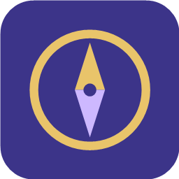
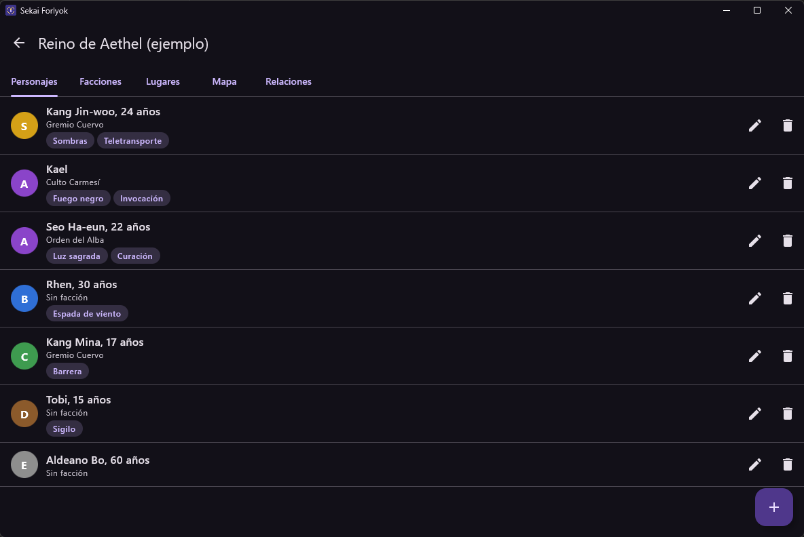
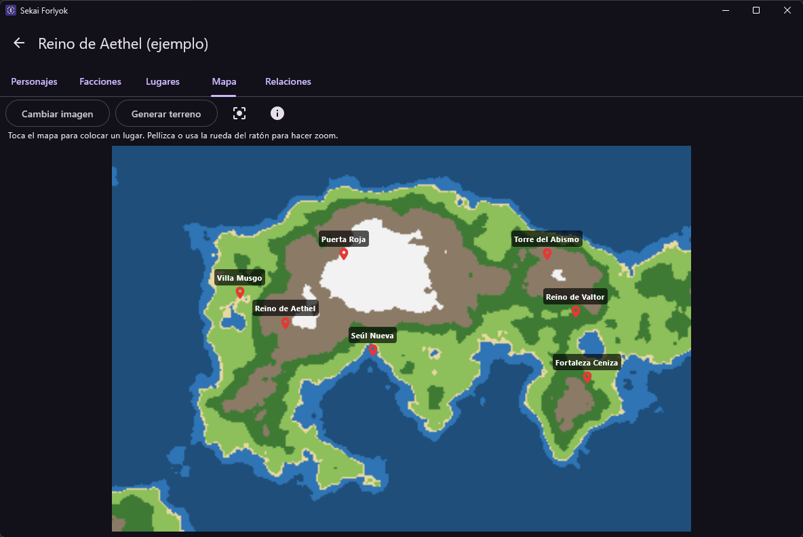
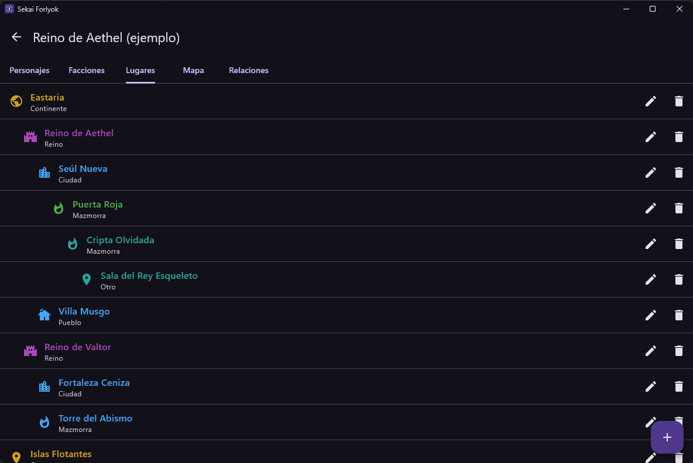
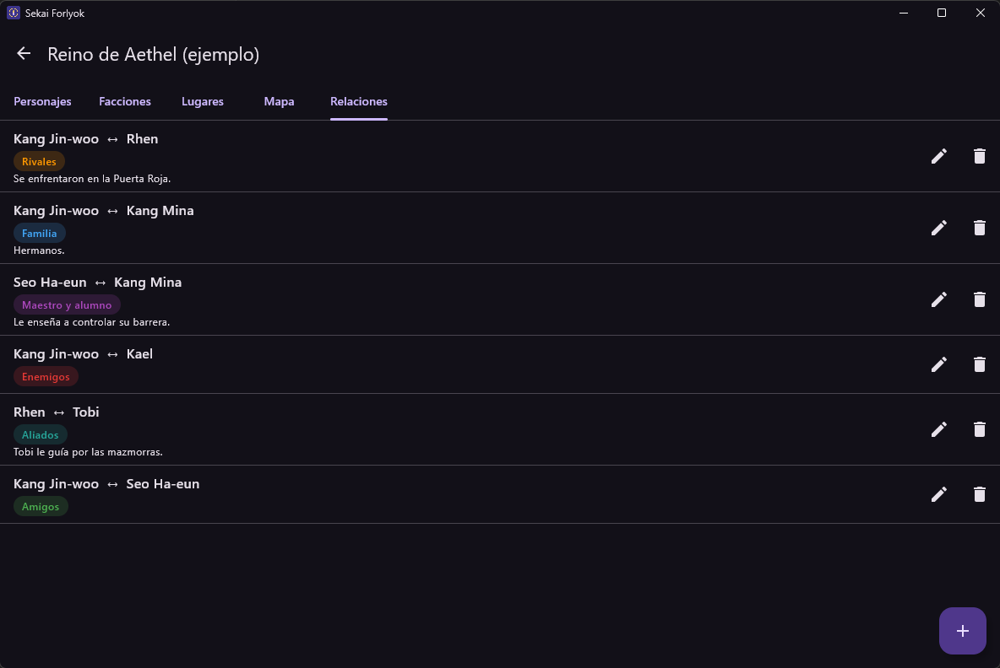
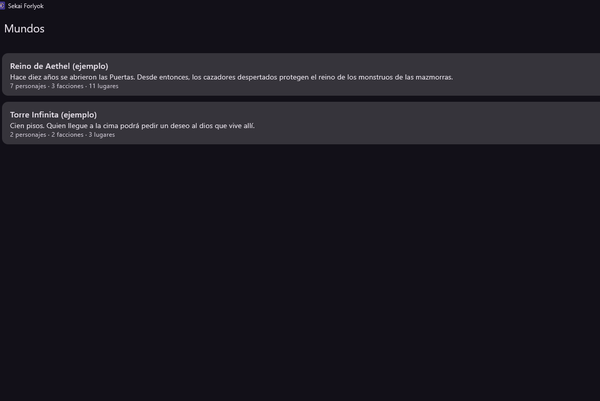
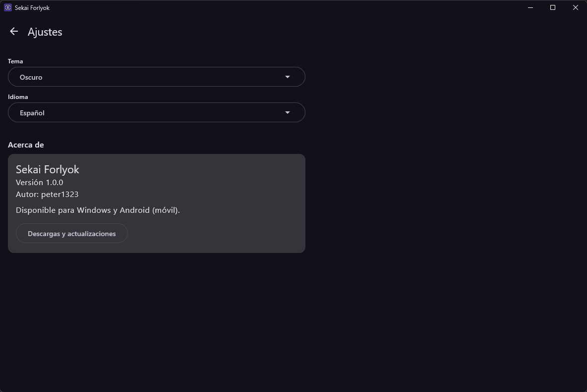

<p align="center">
  
</p>

<h1 align="center">Sekai Forlyok</h1>

<p align="center">
  Creador de personajes y mundos al estilo manhwa<br>
  Creado por <a href="https://github.com/peter1323">peter1323</a>
</p>

Creador de personajes y mundos al estilo manhwa para **Android** y **Windows**.
Está hecho con Kotlin Multiplatform y Compose Multiplatform, y funciona sin internet.

<p align="center">
  
  
</p>
<p align="center"><i>Personajes · Mapa</i></p>
<p align="center">
  
  
</p>
<p align="center"><i>Lugares · Relaciones</i></p>
<p align="center">
  
  
</p>
<p align="center"><i>Mundos · Ajustes</i></p>

## Qué hace la app

- **Mundos:** crea, edita y borra mundos. Cada mundo muestra cuántos personajes, facciones y lugares tiene.
- **Personajes:** nombre, edad, rango (E, D, C, B, A, S), poderes, facción, lugar de origen e historia.
  La lista va ordenada de S a E, con un círculo de color por rango
  (E gris, D marrón, C verde, B azul, A morado, S dorado).
- **Facciones:** cada una muestra su número de miembros. Si borras una, sus miembros se quedan sin facción.
- **Lugares:** se muestran en árbol (continente > reino > ciudad…) con un icono según el tipo.
  Un lugar no puede estar dentro de sí mismo ni de sus sublugares. Si borras uno, sus hijos suben un nivel.
- **Mapa:** carga una imagen JPG o PNG o genera un terreno dentro de la app.
  Tiene zoom y desplazamiento, y puedes colocar tus lugares con pines rojos.
- **Relaciones:** amigos, rivales, enemigos, pareja, familia, maestro y alumno, aliados u otro, con una nota opcional.

- **Ajustes:** tema claro, oscuro o el del sistema; idioma español o inglés; autor y enlace a las descargas.

### ¿Cómo consigo un mapa bonito?

Te recomendamos crear tu mapa fuera de la app y traerlo en JPG o PNG:

- **[Azgaar's Fantasy Map Generator](https://azgaar.github.io/Fantasy-Map-Generator/)**: gratis y sin límites.
- **[Inkarnate](https://inkarnate.com/) (plan gratis)**: estilo dibujado a mano; máximo 3 mapas, 2K y solo uso personal.
- **Pídeselo a una IA**: describe el terreno que quieres (continentes, montañas, ríos, estilo manhwa…),
  genera la imagen y cárgala en la app.

También puedes pulsar **Generar terreno**: la app crea un mapa aleatorio sencillo (mar, playa, llanura,
bosque, montaña y nieve) sin necesidad de internet.

## Estructura (MVVM)

```
composeApp/src/
├── commonMain/kotlin/com/sekaiforlyok/   ← casi todo el código (común a Android y Windows)
│   ├── model/        Modelos.kt          Datos: Mundo, Personaje, Faccion, Lugar, Relacion
│   ├── data/         Repositorio.kt      Guarda y carga los mundos en mundos.json
│   ├── viewmodel/    MundosViewModel.kt  Lógica de la lista de mundos
│   │                 MundoViewModel.kt   Lógica de las 5 pestañas de un mundo
│   │                 ReglasMundo.kt      Reglas: borrar en cascada, árbol de lugares…
│   │                 GeneradorTerreno.kt Generador de mapas aleatorios
│   ├── ui/           App.kt y pantallas  Solo muestran el estado y llaman al ViewModel
│   └── Plataforma.kt                     Funciones "expect" que cada plataforma implementa
├── androidMain/                          Carpeta de datos y lectura de imágenes en Android
├── desktopMain/                          Carpeta de datos, imágenes y ventana de Windows
└── commonTest/                           Pruebas de las reglas del mundo
androidApp/                               Solo la Activity que arranca la app en Android
```

Cómo fluye la información:

1. La **pantalla** (ui) muestra lo que le da el ViewModel y le avisa cuando el usuario hace algo.
2. El **ViewModel** aplica la lógica (por ejemplo, al borrar un personaje también borra sus relaciones)
   y le pide al repositorio que guarde.
3. El **repositorio** escribe el JSON en disco y avisa del cambio. La pantalla se actualiza sola
   porque observa un `StateFlow`.

Las pantallas nunca tocan el repositorio directamente.

Dónde se guardan los datos:
- **Android:** en la carpeta privada de la app.
- **Windows:** en `C:\Users\<tu usuario>\SekaiForlyok\` (`mundos.json` y las imágenes de los mapas).

## Requisitos

- JDK 17 o superior.
- Android SDK con la plataforma 37 (se instala desde Android Studio > SDK Manager).
- No hace falta instalar Gradle: el proyecto trae `gradlew`.

## Ejecutar

**Escritorio (Windows):**

```bash
./gradlew :composeApp:run
```

**Android:** conecta un móvil con la depuración USB activada (o abre un emulador) y ejecuta:

```bash
./gradlew :androidApp:installDebug
```

También puedes abrir el proyecto en Android Studio y pulsar ▶ en la configuración `androidApp`.

**Pruebas:**

```bash
./gradlew :composeApp:desktopTest
```

## Generar los instaladores

**APK de Android:**

```bash
./gradlew :androidApp:assembleRelease
```

El archivo queda en `androidApp/build/outputs/apk/release/androidApp-release.apk`.
Está firmado con la clave de depuración, así que se puede instalar directamente en cualquier móvil.
Para publicarlo en Google Play hay que crear una clave propia
(Android Studio > Build > Generate Signed App Bundle / APK) y configurarla en `androidApp/build.gradle.kts`.

**Instalador de Windows (.msi):**

```bash
./gradlew :composeApp:packageMsi
```

El instalador queda en `composeApp/build/compose/binaries/main/msi/`.
Hay que generarlo desde Windows. La primera vez Gradle descarga WiX (la herramienta que crea el .msi).

## Licencia

© 2026 [peter1323](https://github.com/peter1323). Todos los derechos reservados.
Puedes ver el código y usar la app para uso personal; para modificarla, redistribuirla o
publicarla necesitas permiso del autor. Consulta el archivo [LICENSE](LICENSE).
